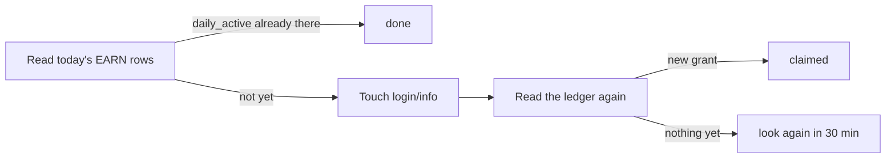

<div align="center">

# magpie-plugin-msmoli

**ModelScope daily credits, claimed for you every day.**

A [magpie](https://github.com/yetone/magpie) plugin that checks in to
ModelScope once a day and puts the balance and today's spend on the
account's usage card. Works with both **modelscope.cn** and **modelscope.ai**.

[](https://www.npmjs.com/package/magpie-plugin-msmoli)
[](https://github.com/MisonL/magpie-plugin-msmoli/actions/workflows/test.yml)
[](LICENSE)

</div>

> [!WARNING]
> ModelScope has no check-in API. This plugin earns the daily grant by
> making a website sign-in happen, which ModelScope's terms may treat as
> abuse. **Read [Purpose, responsibility, and risk](#purpose-responsibility-and-risk)
> before you install it.**

```
● msmoli  API key …a1b2 · 魔搭社区          魔粒 1%  (今日用 2 / 领 250 · 余额 249.5)  ↻ tomorrow 09:31
● msmoli  Mison · 魔搭社区（国际版）        魔粒 0%  (今日用 0 / 领 300 · 余额 300)    ↻ tomorrow 10:00
```

Before the day's grant lands, the line ends with when it will:
`今日用 0 / 领 0 · 余额 300 · 09:56 领取（北京时间）`.

## Contents

- [Features](#features)
- [Quick start](#quick-start)
- [What credits are](#what-credits-are)
- [Purpose, responsibility, and risk](#purpose-responsibility-and-risk)
- [Install](#install)
- [Accounts and sites](#accounts-and-sites)
- [How the check-in works](#how-the-check-in-works)
- [Why its own provider, with no models](#why-its-own-provider-with-no-models)
- [Privacy](#privacy)
- [Scope and limits](#scope-and-limits)
- [Troubleshooting](#troubleshooting)

## Features

| | |
|---|---|
| 🗓️ **Daily check-in** | Claims the 200 + 50 daily grant once per Beijing day, per account |
| 📊 **Usage card** | Balance, today's spend and earnings, and when the soonest credits expire |
| 🌏 **Two sites, one card** | modelscope.cn and modelscope.ai accounts side by side; each token's site is found automatically |
| ⏰ **Check-in window** | Claims at an account's own minute in a configurable window (default 08:30–10:00) |
| 🔒 **Token stays put** | Lives only in magpie's `plugin-auth.json`; masked in every message the plugin or its CLI prints |
| 🔁 **Sync CLI** | Copies the key you already gave magpie's ModelScope preset into the plugin |

## Quick start

```bash
magpie plugin add magpie-plugin-msmoli
printf 'ms-your-token\n' | magpie plugin login msmoli
```

Then turn the check-in on: **Settings → Usage → Plugins → `msmoli`**.

Get the token from your site's access-token page:
[modelscope.cn](https://modelscope.cn/my/myaccesstoken) ·
[modelscope.ai](https://modelscope.ai/my/myaccesstoken).

## What credits are

ModelScope's API-Inference is free, paid in credits:

| Grant | Amount | Expires |
|---|---|---|
| Sign-in, per day | 200 | 24 hours |
| Aliyun account bound, per day | 50 | 24 hours |
| Email / profile / homepage completed | 50 each | 90 days, once |

Daily grants last **24 hours only** and do not accumulate: what you don't
spend today is gone. A flagship model costs 2 credits per call (mainstream 1,
lightweight 0.5), so the daily 250 is roughly 125 calls.

The day's numbers come from the ledger, which a busy account can spread over
several pages. When a page cannot be read (a 5xx, a budget already gone), the
card does not present a floor as a fact: its line ends with
`账单未读完，数字偏低`. A check-in in that state does not read "no grant" into
a ledger it could not finish either — it answers `failed` and the host retries
in half an hour.

## Purpose, responsibility, and risk

**What it is for.** A personal utility: it claims the daily credit grant of the
ModelScope account *you* sign in, and does nothing else. It is not an
official ModelScope product; it is not affiliated with ModelScope, Alibaba or
magpie, and it collects nothing about you. The token stays in magpie's own
`plugin-auth.json`, and every request goes to the site the account signed in
to.

**The risk you are taking.** ModelScope has no check-in endpoint. The daily
grant exists for a *real* website sign-in, and this plugin obtains it by
calling `login/info` once a day with the browser's session cookie: a script
posing as the browser, not a button the official client offers. ModelScope's
user agreement forbids plugins that interfere with the service (4.1.2(1)) and
point farming with third-party tools (4.1.2(5)), and lets the platform freeze a
user's benefits or blacklist them for abuse (2.3.1 and the credit rules). An
account is real-name verified and often tied to Aliyun, so what is at stake is
the account, not the 250 credits that expire the same day. No account has been
reported frozen for running this, and no one can promise one never will be.
Whether to run it is a decision about your own account.

**Responsibility.** You are responsible for complying with ModelScope's terms
when you use this. The software is provided under the MIT licence, without
warranty of any kind; the maintainer is not liable for a suspended or frozen
account, lost credits, or anything else that follows from running it. See
[LICENSE](LICENSE).

**Not in the magpie market, and it will not be submitted.** magpie's community
market declined to list this package for exactly the reason above
([plugins#714](https://github.com/magpie-community/plugins/pull/714)), and the
project has decided not to submit it again. It stays installable by name from
npm.

## Install

You need magpie itself (<https://usemagpie.ai>). On macOS, `magpie --version`
tells you whether it is on `PATH`; if not, use the app's full path,
`/Applications/magpie.app/Contents/MacOS/magpie`.

The plugin relies on the host's plugin API — the account scope a check-in and
a usage read run in, the provider argument `auth.checkin` is handed, the
`input.directory` the plugin's own folder comes from, and `auth.set` writing
back into the same account. It is checked against **magpie 0.1.3354**; an older
host may lack part of that contract.

Pick one of three ways. They all end the same: an `msmoli` row under
**Settings → Usage → Plugins**. The sign-in is kept per provider id, not per
folder, so switching between them (or moving a clone) keeps the token.

<table>
<tr><th>From npm (recommended)</th><th>From GitHub</th><th>From a clone</th></tr>
<tr valign="top">
<td>

```bash
magpie plugin add \
  magpie-plugin-msmoli
```

`magpie plugin update` follows npm releases.

</td>
<td>

```bash
magpie plugin add \
  github:MisonL/magpie-plugin-msmoli
```

Installed into magpie's plugin folder; updates with `magpie plugin update`.

</td>
<td>

```bash
git clone https://github.com/MisonL/magpie-plugin-msmoli.git
cd magpie-plugin-msmoli
magpie plugin add "$PWD"
```

Referenced in place: it loads only while the folder exists. Update by pulling.

</td>
</tr>
</table>

Then sign in and turn the check-in on:

```bash
printf 'ms-your-token\n' | magpie plugin login msmoli
```

The switch is **Settings → Usage → Plugins → `msmoli`**, or `settings.json` in
magpie's own folder (`~/.config/magpie` for an installed magpie):

```json
{ "pluginCheckins": { "msmoli": true } }
```

One more optional step. The Providers row reads **未暴露模型 / no models
exposed** — accurate (the plugin registers no models) but it reads like
something failed. Say it serves none on purpose, and the row reads **仅看用量
/ usage only**:

```bash
magpie provider models msmoli none
```

The same `ms-` token is both the inference `Authorization: Bearer` and the web
session cookie, so nothing else needs configuring.

### Already use ModelScope for chat? Sync that key

If you added ModelScope to magpie earlier for chat, its key is already in
`providers.json`. The bundled CLI logs the same token into the plugin:

```bash
npx magpie-plugin-msmoli --status      # see both sides, change nothing
npx magpie-plugin-msmoli --to-plugin   # copy the preset's key into the plugin
```

From a GitHub install, run magpie's own copy instead:
`node ~/.config/magpie/plugins/node_modules/magpie-plugin-msmoli/bin/sync.mjs`.
From a clone, run `./bin/sync.mjs` (or `node bin/sync.mjs` on Windows and
WSL). npm 12 blocks `npx github:…` by default, so don't start from that.

`npx`, `magpie plugin add magpie-plugin-msmoli` and `magpie plugin update` all
follow the npm package. The current release is **0.3.0**: one provider for
both sites, the row-level ledger dedupe, the chunked-echo masking, and the
budgets this document describes.

If you are on **0.2.0**, that version ships an older `bin/sync.mjs` with both
directions, but it keeps the international site in a second provider and
predates this round of fixes. Upgrade (`npm i -g magpie-plugin-msmoli@latest`
or `magpie plugin update msmoli`) to get what this document describes.

It syncs the **domestic site only**: the built-in preset it reads is the
`modelscope.cn` one. Sign an international account in by hand.

| Flag | What it does |
|---|---|
| `--status` | Report both sides and the plan; write nothing |
| `--to-plugin` | Log the preset's key into the plugin |
| `--to-preset` | The other way round; a preset that already holds a different key needs `--force` |
| `--force` | Replace a single existing plugin account whose key differs |
| `--from <id>` | Pick the preset when more than one provider could be it |
| `--dry-run` | Print the commands, masked, without running them or writing anything; no magpie binary needed |
| `--dir <folder>` | Where magpie's config is (a portable install's `data` folder) |
| `--magpie <path>` | Path to the magpie binary; a bare `magpie` is refused |
| `--version` | Print the version (read from the package's own `package.json`) |

<details>
<summary><b>How the CLI keeps your config and your token safe</b></summary>

- **It never writes magpie's files itself.** It reads them directly, and every
  write goes through magpie's own CLI (`magpie plugin login`,
  `magpie plugin logout`, `magpie provider key`).
- **A preset with no key is filled without `--force`, in either direction.**
  There is nothing to overwrite; `--force` is for replacing a different key
  that chat may be using.
- **It never adds a second account by accident.** Same key on both sides: it
  changes nothing. Different keys: it refuses, because a second `login` would
  add an account. `--force` replaces only when exactly one account exists.
- **It reads and writes the same magpie.** `--dir` says where to read; magpie's
  CLI has no such flag, so a write always lands in the binary's own folder. If
  `--dir` and `--magpie` name different places, it stops before writing.
  "Different" means different folders, not different strings: a trailing
  slash, `/private/tmp` vs `/tmp` on a Mac, and `data/.` all count as the same.
- **`--magpie` must be a path.** A bare `magpie` resolves through `PATH`, and
  the first `magpie` on it would be handed the token.
- **A value flag given twice is refused**, not silently last-wins.
  `--dir=<folder>` is read as well.
- **The token is masked in everything it prints, failures included.** That
  covers magpie's own output, and keys of other shapes too: GitHub and Slack
  tokens, AWS secrets, UUIDs, hex digests, base64 bodies. A key with a space,
  newline or invisible character pasted into it is still masked whole, and so
  is one printed another way: upper-cased, in full-width characters, or broken
  into short groups (`ms-01234 56789abc …`), and so is a vendor key cut the
  same way (`ghp_ 1234 AbCd 5678 …`, `sk-a nt-a pi03 …`, one character per
  word, `AKIAIOSF ODNN7EXA MPLE`) — the words are judged as one key joined
  back up. A value that starts like a path keeps its shape, and only the
  key-like part inside it is masked, so `--dir /tmp/ghp_16C7…` still names the
  folder. What the masking cannot know: a key typed into an argument the CLI
  does not know, inside a path segment (`/keys/sk-ant-…`), and a run of words
  that reads as prose as well as as a key.

</details>

## Accounts and sites

### The international site (modelscope.ai)

There is one provider, `msmoli`, and it serves both sites. Tokens are
site-specific (a `modelscope.cn` token answers 401 on `modelscope.ai`, and the
other way round), so the plugin works out each account's site from its token:

1. The first read goes to the domestic site.
2. A 401 sends it on to the international one, and so does a failure that is
   not an answer at all (a transport error, a proxy's page, a 5xx, a JSON 429):
   those say nothing about which site holds the token. The same is true of a
   *remembered* site that times out or answers with nothing usable (a 4xx as
   well as a 5xx): it is not the only site tried, the other one is asked
   within the same request budget. When nothing else answers, the first
   answer is the one reported.
3. The answer is remembered for the rest of the process (the last 64 tokens
   seen, oldest evicted first), and an international
   one is also kept on the sign-in (`site`), so a restarted host goes straight
   there instead of paying the 401 again. A 401 from a remembered site drops
   it and the *other* site is asked — the sign-in may have been re-keyed with
   a token of the other site, and the site that just refused the token is not
   worth a second request.

The card's plan line tells you which site an account is on (`魔搭社区` or
`魔搭社区（国际版）`), and a 401 names the site that refused (or 任一站点 when
both did).

To add an international account, sign in again with that site's token. It
lands under the same `msmoli` card:

```bash
printf 'ms-your-intl-token\n' | magpie plugin login msmoli
magpie accounts            # both accounts, each with its own credit window
```

If you are coming from 0.2.0, which kept the international site in a second
provider called `msmoli-intl`: that provider is gone, and the sign-in filed
under it is not read by this version. Sign in once more under `msmoli` with
the same token (the command above), and the card picks the account up. Aliases
set on the old `msmoli-intl` row belong to a provider this version no longer
has.

### More than one account

The plugin works per account, not per token. magpie keeps each signed-in token
under its own key (the first as `msmoli`, later ones as `msmoli#xxxxxx`) and
asks the check-in once per account. With two tokens:

- each account gets **its own target minute** that day (hashed from the day
  and that account's token), so they normally claim at different minutes;
- each account's check-in is recorded, retried and shown separately;
- the name read at check-in is cached per token, so one account's nickname
  never appears on another's row.

Three things worth knowing once there are two:

- Signing the **same token in twice** can leave two account rows: magpie folds
  a repeated sign-in into the first row only while neither row carries a name
  (host.js's `settle`), so once the nickname is there the second sign-in is a
  row of its own. Both are asked; the day's grant lands once, and the second
  answers `done`. Remove one in the editor to quiet it.
- Dropping **one account** of several: **Remove** on its row in the provider's
  editor, or `magpie accounts forget msmoli "<the account as its card shows
  it>"`. `magpie plugin logout msmoli` is the blunt one — it takes no account
  name, so it forgets the provider's whole sign-in.
- An **alias** is kept under the account's label of the moment (see [Account
  names](#account-names)). Remove an account and sign in again and the label
  resets to the key's tail, so an alias you set under the nickname re-attaches
  only once the next check-in writes the nickname back — or just set it again.

The check-in switch, the card and the window (`msmoli.json`) are per provider,
so one setting covers every account, whichever site it is from.

The daily grant belongs to the ModelScope account, not to the key: a second
token for the same ModelScope user gets `done` rather than another 250.

### Account names

The card names an account by its ModelScope nickname. An api-type sign-in has
no name, so the first check-in that runs writes the nickname back as
`accountId` on the same sign-in (the token is still stored once). Until then a
fresh install shows `API key …a1b2`. A day already settled is not re-claimed,
but the name is still worth a `login/info` read, so the nickname appears on
the first ask after sign-in rather than with the next day's claim.

To choose the name yourself, magpie's own alias wins:

```bash
magpie accounts alias msmoli "API key …a1b2" my-main
```

The second argument is the account as the card shows it *now*: the key's tail
before the first check-in, the nickname after. An account you have named is
left alone; the check-in never writes over your alias.

## How the check-in works

ModelScope publishes no check-in endpoint. What it does have is a side effect:
`GET /api/v1/users/login/info` counts as a sign-in, and the first one of the
day grants `daily_active` 200 and `aliyun_bindlogin` 50. Repeating it the same
day grants nothing more.

A hook that just calls it can't tell "claimed now" from "claimed hours ago", so
this one reads the ledger around it:



| Outcome | Meaning |
|---|---|
| `done` | already claimed today, with the day's total |
| `claimed` | this run claimed it, with the amount; a row that was there before the touch is never counted as this run's |
| `inactive` | the sign-in went through but nothing was granted (from noon on, checked once more 30 minutes later before it stands for the day) |
| `failed` | nothing was claimed, including "not yet time" (see below) |

When the touch went through but the ledger still shows nothing, the plugin
asks magpie to look again half an hour later (`until`), once. Before Beijing
noon magpie's own 30-minute re-ask already covers it.

A `done` or `claimed` also carries the streak: how many Beijing days in a row
the ledger shows a daily grant, today included. magpie prints it as
`3-day streak` beside the outcome. The ledger's `total` tells the plugin
whether one page is the whole ledger; when it is not — or is missing, or the
rows contradict it — and the run is still going at the oldest row, the next
page is read, up to eight. A run it could not follow to its end — a page that
fails, or one longer than those eight pages — is left unsaid rather than
printed short, because magpie shows any number it is given.

<details>
<summary><b>Endpoints and the ledger</b></summary>

Every request goes to the account's own site (`modelscope.cn` or
`modelscope.ai`) with `Cookie: m_session_id=ms-…`. A browser UA and a
`Referer` are enough; no CSRF token.

| Purpose | Path |
|---|---|
| Sign-in / check-in trigger | `GET /api/v1/users/login/info` |
| Balance | `GET /openapi/v1/magicubes/balance` |
| Ledger | `GET /openapi/v1/magicubes/transactions?page=1&page_size=50` |

The ledger's `type` has been seen as `EARN` and `SPEND_CONFIRM`; there is also
an `EXPIRE`, which the plugin ignores. Rows are aggregated per day, type,
`rule_key` and `model_tier`, with a `count` on each, and sorted newest first.
The ordering is what makes the first page enough in the common case: today's
rows always come first. A live account shows 3–7 rows a day, so a page reaches
back about a fortnight. A single day with more than 50 rows is followed onto
the next page (up to `DAY_PAGES` extra pages), and a walk that cannot finish is
answered with the numbers it saw and marked `未读完`. Asking for a bigger page
doesn't help: the server answers `page_size=200` with 50.

</details>

### When it claims: the check-in window

The claim waits until a time of day, by default an account's own minute in
**08:30–10:00 Beijing time**, picked from a hash of the day and the account so
it doesn't move between retries. The traffic looks like a person opening the
site in the morning, not a script at midnight. The times this plugin itself
names say **北京时间** — the day ModelScope grants in is Beijing's wherever
magpie's own clock is — while times magpie adds around them (a window's reset)
are in the machine's zone.

Waiting costs nothing: daily grants expire **24 hours after they land**, so
claiming at 9am leaves the credits good until 9am tomorrow.

Set the window in `msmoli.json` in magpie's own folder (`~/.config/magpie` for
an installed magpie, the data folder for a portable one). The file is read on
every check-in ask (and by a usage read only while the day has no credit yet
to show), so changes apply without restarting magpie.

```json
{ "checkinWindow": ["08:30", "10:00"] }
```

| Value | Effect |
|---|---|
| `["08:30", "10:00"]` or `"08:30-10:00"` | claim inside that window |
| `false`, `"off"`, `"no"` | no window; claim whenever magpie asks |
| an unusable value (end before start, not a clock time) | falls back to the default |
| an end past **23:00** | capped at 23:00; a window entirely past it falls back to the default |

<details>
<summary><b>Why "failed" before the window, and why the 23:00 cap</b></summary>

magpie asks once when the Beijing day turns, then every 30 minutes: always
after a `failed`, and after a `done`/`inactive`/`ineligible` only until Beijing
noon. So before the window's moment the plugin answers `failed` with the time
it will run, and sends **no request at all**. `failed` is the one outcome that
guarantees a re-ask.

What that costs, since a plugin has no other way to defer: until the claim
runs, the card shows a red dot and magpie's "check-in failed; tries again
later" wording, under the line
`09:56 后自动领取（北京时间，magpie 每半小时问一次，无需操作）`.
Each such ask rewrites `plugin-checkin.json`, and `magpie accounts checkin` run
in that period exits non-zero. Turning the window off removes all three.

**Check in now** (Settings → Usage → Plugins) does not claim early either: the
plugin cannot tell a manual press from the host's half-hourly ask — both reach
it through the same `auth.checkin` call — so before the target minute it
answers the same line. After the target, the button claims like any ask.

How long it lasts depends on when magpie next asks. On a measured day the
target was 09:01, magpie asked at 09:00:57 (three seconds early, so `failed`),
and the claim landed on the next ask at 09:31. That is also why the card names
the time and the cadence instead of a countdown: the line stays up for half an
hour, so a countdown ("in about 8 minutes") would be wrong for most of that time.

The cap: magpie's asks run on a 30-minute phase of their own, so the first ask
after a target can be up to half an hour late, and the retry after a failure
half an hour after that. Both have to land on the same day, or the day's
credits are lost. Ending the window at 23:00 leaves every target that room.

</details>

### Upstream

magpie gives a plugin no timer, no clock, and no say in when it is called:
`auth.checkin(getAuth, info)` returns an outcome and the host decides when to
ask again. Everything above works within that contract.
[yetone/magpie#3245](https://github.com/yetone/magpie/issues/3245) proposes
timers and `recheck` for plugins.

Two consequences of the missing timer: a target that falls while the machine
is asleep is claimed on the first ask after it wakes (the day is lost only if
that is past midnight), and the plugin cannot retry on its own between asks.

## Why its own provider, with no models

The plugin registers `msmoli` instead of riding on the built-in `modelscope`
preset:

1. magpie renames a plugin id that collides with a preset to `<id>-plugin`, so
   a plugin called `modelscope` would not be the same provider anyway.
2. **Safety.** magpie's gateway passes over an account whose usage window reads
   as used up. If a check-in plugin served the provider chat routes through,
   reporting 100% would take the whole chat path out of magpie.

So chat keeps using the `modelscope` preset with your API key, and this plugin
only carries the sign-in its check-in runs as. The Providers page shows both:

| | `ModelScope` (preset) | `ModelScope 魔粒` (this plugin) |
|---|---|---|
| Serves chat models | yes | no; `magpie models` never lists it |
| Usage card | none (no balance endpoint) | the credit balance and today's spend |
| Check-in | not built in | once a day |
| Used by the gateway | yes | no, so a card at 100% can't block chat |

Its row reads 未暴露模型 / no models exposed until told it serves none on
purpose; `magpie provider models msmoli none` (see [Install](#install)) makes
it read 仅看用量 / usage only. Either way nothing is served.

Entering the same `ms-` token in both is expected: a preset keeps its key in
`providers.json`, a plugin in `plugin-auth.json`. They fail independently;
remove either and the other keeps working. International accounts are extra
accounts under the same `msmoli` row, not new rows.

> [!TIP]
> The preset's card is empty because ModelScope's inference API has no balance
> endpoint, so the gateway only learns the credits are gone from the vendor's
> `429 insufficient balance`. You can give the preset a reading: in its editor,
> set Balance URL `https://modelscope.cn/openapi/v1/magicubes/balance` and
> Balance field `data.available_balance`. `magpie quota modelscope` then shows a
> number.

## Privacy

`login/info` returns `Email` and `GitlabAccessToken` among other fields. The
plugin reads `NickName` / `Name` and drops the rest as soon as the response is
parsed. The token lives only in magpie's own `plugin-auth.json`: the plugin
never writes it anywhere, never logs it, and never sends it anywhere but the
two ModelScope sites (`modelscope.cn` and `modelscope.ai`) — the domestic one
first, and the international one when the domestic one refuses the token, or
when the sign-in is already known to belong there.

The one place a token could still be copied is the account name: a reply whose
`NickName` is the token, or a piece of it, or a key of a vendor's shape
(`sk-…`, `ghp_…`, `AKIA…`) is not written back as `accountId` and is masked
on the card instead. A name that happens to begin like one is refused too: `sk-`
is a key's front before it is a nickname. Whether a name reads as a key is the
card's own question, asked of the name as written, so "ms-office 2016",
"ms-cli 2026.11.9" and all-capitals names ("CHRISTOPHER LEE 2026") are names
and are written back. Three situations the mask cannot cover: the
first 4 and last 4 characters of the token do appear, that is the mask; a key
of a shape this plugin does not recognise, echoed back in a spelling it does
not fold (the `ms-` shapes are covered in any case and full width); and a word
that is already masked is not judged again, so its ellipsis is printed as the
mask it is.

Text from the server that carries a key cut by whitespace is masked the same
way as the CLI's (`ghp_ 1234 AbCd …`, `sk-a nt-a pi03 …`), via the same
reading: a run of words that joins back into a key. The cut it reads across
is a space, a no-break or ideographic space, a line break, or a middot or a
bullet (one or two in a row, at most one space either side) — a value copied
out of a web page or a Chinese IME carries these as often as plain spaces. A
middot is read across when a piece beside it is not a word (`A·K·I·A·…`,
`9f8e·7d6c·…`, the pieces of a key cut in fours), and a run of single-character
pieces is read whatever the separator (`A· K· I· A· …`). The card's own middot
sits between words on both sides ("Qwen3-Max · 调用返还") and stays as written;
a middot inside a key stays in its mask when the mask shows only its ends,
because the mask keeps everything between the first four characters and the
last four. A full-width hyphen
(`－`, which Unicode does not fold) is read as the key's own. A run that also
reads as an ordinary sentence is left alone.

The run readings give up on a body past 32 KiB and only the per-word pass
runs: a body of thousands of one-word pieces ("s k - a n t" repeated) costs
two orders of magnitude more reading than any message this pass exists for,
and a key stored inside such a body as whole words is still masked. The
bound exists so a hostile server's error cannot eat a hook's budget.

A piece is masked only when it carries ten characters of the key's own —
**letters and digits, not the hyphens or spaces the token was written in**. A
five-character slice of a hyphenated key (`ms-…`'s middle `c-3333`) is left as
it is written: no one can read a full key out of a slice that short, and
masking every string that shares six characters would eat ordinary words. The
same floor is what keeps a nickname a person actually picked ("Mison 2026")
from being refused as an echo.

A key quoted in a frame keeps the frame: `(ghp_…Qrst)`, `[ghp_…]`, `"ghp_…"`.
The mask spends four characters at each end on the key's own, so the brackets
are printed as written rather than eaten by it.

The plugin writes two things, both onto the sign-in it already has and through
the host's own `client.auth.set`: the nickname, as `accountId` (so the card
reads "Mison" instead of "API key …a1b2"), and, for an international account,
the site as `site`. It re-reads the sign-in through the host first and writes
onto that copy, so a key you paste or a field you add while a check-in runs is
not replaced by an older read. It hands back what the host gave it with those
fields added, so the token is still stored once. An account on the domestic
site carries no `site`: a probe tries that one first anyway.

It reads `providers.json` for one thing only: whether you already named the
account yourself. A name you chose is never overwritten. The `site` of an
international account is written even then — it is not a name, and it only
saves the probe.

## Scope and limits

The terms and risks are in
[Purpose, responsibility, and risk](#purpose-responsibility-and-risk).

- **Requests per day.** A check-in is three requests (ledger, touch, ledger);
  a day already claimed answers `done` in one ledger read when the nickname
  is known, two otherwise; a ledger that hasn't caught up takes
  four. A run longer than one ledger page adds one read per page walked back,
  up to seven — only while the streak is still going at the oldest row. A day
  whose own rows fill a page (a busy account) reads the next page too, up to
  four more, for both the check-in and the card. Asks before the window send
  nothing. A usage read is two requests and never touches the sign-in
  endpoint, so menu-bar polling cannot turn into check-ins.
- **International accounts cost one extra 401 per token, per process**, and
  that 401 is on the first read that does not already know the site: the
  sign-in's `site` field saves it after a restart, so an international usage
  read is three requests the first time (domestic 401, balance, ledger) and two
  after that. A domestic account costs nothing extra. A remembered site that
  401s drops the memory and probes again; one that times out or answers
  nothing usable is asked no more than the other site, so a dead link costs
  the 8-second request timeout, not the whole budget.
- **Time limits.** Every request gives up after 8 seconds, body included, and a
  body is read to at most 256 KiB. A whole check-in gives up after 25 seconds
  and a usage read after 18, because magpie runs every provider's check-ins
  under one two-minute budget. A hook cut short answers `failed`, the host
  retries in half an hour, and the retry reads the ledger first, so nothing is
  lost.
- **What a 401 or a 403 says.** A 401 signs the account out only when it
  reads as the site refusing the token — "unauthorized", an invalid or expired
  token, a refusal in Chinese ("请先登录", "登录状态已失效"), an empty JSON
  object, or a code of 401 — and never when it names the path instead ("proxy
  authentication required", a gateway's page, a bodyless 401). A 403 is
  reported as ModelScope's risk control only when it carries ModelScope's
  shape; a proxy's 403 page is reported as an ordinary refusal. A sign-in
  that was refused after the day's credits landed reports the expiry but
  keeps the day's answer.
- **A body it doesn't understand fails; it never reads as zero.** A missing
  `data`, a list where an object belongs, a missing or non-numeric
  `available_balance`: each is a failure with its reason, because
  "0 魔粒可用" would be a definite and false answer. Server text (a message, a
  grant's title) has any key in it masked before it reaches the card or the log.
- `MAGPIE_MSMOLI_CONFIG` overrides the config file's path. It exists for the
  test suite, and works in production too.
- The other 170 credits a day (liking items, posting AIGC works and models) have
  no API and would mean driving the web UI. This plugin doesn't touch them.

## Troubleshooting

| Symptom | Fix |
|---|---|
| `没有登录信息，请先登录` | `printf 'ms-token\n' \| magpie plugin login msmoli` |
| No credit window on the card, or no check-in | Restart magpie; the plugin host caches. |
| `failed` with HTTP 401 | The token was revoked, or belongs to the other site; `modelscope.cn` and `modelscope.ai` don't share tokens. The message names the site that refused (国内站 / 国际站), or 任一站点 when both did. Make a new token there and sign in again. |
| `failed` with HTTP 403 | ModelScope's risk control refused the request; the token is fine. A check-in is asked again in 30 minutes; a usage read shows the 403 on the card until the next poll. |
| Before the window: failed, with `09:56 后自动领取（北京时间，magpie 每半小时问一次，无需操作）` | Expected. See [When it claims](#when-it-claims-the-check-in-window). |
| Check in now before the target minute answers failed with the same line | Expected. A manual press and the host's half-hourly ask reach the plugin the same way, so only the target minute starts the claim. |
| Always `inactive` | The sign-in works but today's ledger shows nothing: the account may not be eligible, or the grant hasn't been written yet. Before noon magpie re-asks every 30 minutes; from noon the plugin checks once more ("半小时后再核对一次"), and only the second `inactive` stands. |
| Chat through the `modelscope` preset answers `429 insufficient balance` | The day's 250 credits are spent (~125 flagship calls). Not this plugin: it registers no models. See the tip under [Why its own provider](#why-its-own-provider-with-no-models). |
| Two accounts with the same nickname, and only one checks in | magpie before 2026-10-20 kept check-ins per display name. Update magpie (fixed in magpie-community/plugins#254). |
| Edits to a clone do nothing | Path plugins are referenced in place; restart magpie. |
| `magpie plugin list` says `msmoli` is "served by" one of two copies | It was installed two ways. Remove one with `magpie plugin rm github:MisonL/magpie-plugin-msmoli` or `magpie plugin rm <path>`. The alias is filed with the package it was set against, so you may need to set it again. |

## License

[MIT](LICENSE). Contributions welcome; see [CONTRIBUTING.md](CONTRIBUTING.md).
