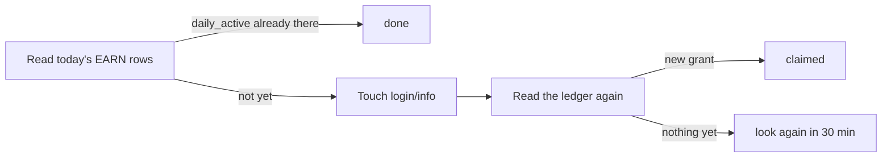

<div align="center">

# magpie-plugin-msmoli

**ModelScope 魔粒, claimed for you every day.**

A [magpie](https://github.com/yetone/magpie) plugin that checks in to
ModelScope (魔搭) once a day and puts the balance and today's spend on the
account's usage card. Works with both **modelscope.cn** and **modelscope.ai**.

[](https://www.npmjs.com/package/magpie-plugin-msmoli)
[](https://github.com/MisonL/magpie-plugin-msmoli/actions/workflows/test.yml)
[](LICENSE)

English · [简体中文（旧版）](README.zh-CN.md)

</div>

> [!WARNING]
> ModelScope has no check-in API. This plugin earns the daily grant by
> making a website sign-in happen, which ModelScope's terms may treat as
> abuse. **Read [Purpose, responsibility, and risk](#purpose-responsibility-and-risk)
> before you install it.**

```
● msmoli  API key …a1b2 · 魔搭社区          魔粒 1%  (今日用 2 / 领 250 · 余额 249.5)  ↻ tomorrow 09:31
● msmoli  Mison · 魔搭社区（国际版）        魔粒 0%  (今日用 0 / 领 300 · 余额 300)    ↻ tomorrow 10:00
```

## Contents

- [Features](#features)
- [Quick start](#quick-start)
- [What 魔粒 is](#what-魔粒-is)
- [Purpose, responsibility, and risk](#purpose-responsibility-and-risk)
- [Install](#install)
- [Accounts and sites](#accounts-and-sites)
- [How the check-in works](#how-the-check-in-works)
- [Why its own provider, with no models](#why-its-own-provider-with-no-models)
- [Privacy](#privacy)
- [Scope and limits](#scope-and-limits)
- [Troubleshooting](#troubleshooting)

## Features

| | |
|---|---|
| 🗓️ **Daily check-in** | Claims the 200 + 50 daily grant once per Beijing day, per account |
| 📊 **Usage card** | Balance, today's spend and earnings, and when the soonest credits expire |
| 🌏 **Two sites, one card** | modelscope.cn and modelscope.ai accounts side by side; each token's site is found automatically |
| ⏰ **Check-in window** | Claims at an account's own minute in a configurable window (default 08:30–10:00) |
| 🔒 **Token stays put** | Lives only in magpie's `plugin-auth.json`; masked in every message the plugin or its CLI prints |
| 🔁 **Sync CLI** | Copies the key you already gave magpie's ModelScope preset into the plugin |

## Quick start

```bash
magpie plugin add magpie-plugin-msmoli
printf 'ms-your-token\n' | magpie plugin login msmoli
```

Then turn the check-in on: **Settings → Usage → Plugins → `msmoli`**.

Get the token from your site's access-token page:
[modelscope.cn](https://modelscope.cn/my/myaccesstoken) ·
[modelscope.ai](https://modelscope.ai/my/myaccesstoken).

## What 魔粒 is

ModelScope's API-Inference is free, paid in 魔粒:

| Grant | Amount | Expires |
|---|---|---|
| Sign-in, per day | 200 | 24 hours |
| Aliyun account bound, per day | 50 | 24 hours |
| Email / profile / homepage completed | 50 each | 90 days, once |

Daily grants last **24 hours only** and do not accumulate: what you don't
spend today is gone. A flagship model costs 2 魔粒 per call (mainstream 1,
lightweight 0.5), so the daily 250 is roughly 125 calls.

## Purpose, responsibility, and risk

**What it is for.** A personal utility: it claims the daily 魔粒 grant of the
ModelScope (魔搭) account *you* sign in, and does nothing else. It is not an
official ModelScope product; it is not affiliated with ModelScope, Alibaba or
magpie, and it collects nothing about you. The token stays in magpie's own
`plugin-auth.json`, and every request goes to the site the account signed in
to.

**The risk you are taking.** ModelScope has no check-in endpoint. The daily
grant exists for a *real* website sign-in, and this plugin obtains it by
calling `login/info` once a day with the browser's session cookie: a script
posing as the browser, not a button the official client offers. ModelScope's
user agreement forbids plugins that interfere with the service (4.1.2(1)) and
"刷分" with third-party tools (4.1.2(5)), and lets the platform freeze a
user's benefits or blacklist them for abuse (2.3.1 and the 魔粒 rules). An
account is real-name verified and often tied to Aliyun, so what is at stake is
the account, not the 250 credits that expire the same day. No account has been
reported frozen for running this, and no one can promise one never will be.
Whether to run it is a decision about your own account.

**Responsibility.** You are responsible for complying with ModelScope's terms
when you use this. The software is provided under the MIT licence, without
warranty of any kind; the maintainer is not liable for a suspended or frozen
account, lost credits, or anything else that follows from running it. See
[LICENSE](LICENSE).

**Not in the magpie market, and it will not be submitted.** magpie's community
market declined to list this package for exactly the reason above
([plugins#714](https://github.com/magpie-community/plugins/pull/714)), and the
project has decided not to submit it again. It stays installable by name from
npm.

## Install

You need magpie itself (<https://usemagpie.ai>). On macOS, `magpie --version`
tells you whether it is on `PATH`; if not, use the app's full path,
`/Applications/magpie.app/Contents/MacOS/magpie`.

Pick one of three ways. They all end the same: an `msmoli` row under
**Settings → Usage → Plugins**. The sign-in is kept per provider id, not per
folder, so switching between them (or moving a clone) keeps the token.

<table>
<tr><th>From npm (recommended)</th><th>From GitHub</th><th>From a clone</th></tr>
<tr valign="top">
<td>

```bash
magpie plugin add \
  magpie-plugin-msmoli
```

`magpie plugin update` follows npm releases.

</td>
<td>

```bash
magpie plugin add \
  github:MisonL/magpie-plugin-msmoli
```

Installed into magpie's plugin folder; updates with `magpie plugin update`.

</td>
<td>

```bash
git clone https://github.com/MisonL/magpie-plugin-msmoli.git
cd magpie-plugin-msmoli
magpie plugin add "$PWD"
```

Referenced in place: it loads only while the folder exists. Update by pulling.

</td>
</tr>
</table>

Then sign in and turn the check-in on:

```bash
printf 'ms-your-token\n' | magpie plugin login msmoli
```

The switch is **Settings → Usage → Plugins → `msmoli`**, or `settings.json` in
magpie's own folder (`~/.config/magpie` for an installed magpie):

```json
{ "pluginCheckins": { "msmoli": true } }
```

The same `ms-` token is both the inference `Authorization: Bearer` and the web
session cookie, so nothing else needs configuring.

### Already use ModelScope for chat? Sync that key

If you added ModelScope to magpie earlier for chat, its key is already in
`providers.json`. The bundled CLI logs the same token into the plugin:

```bash
npx magpie-plugin-msmoli --status      # see both sides, change nothing
npx magpie-plugin-msmoli --to-plugin   # copy the preset's key into the plugin
```

From a GitHub install, run magpie's own copy instead:
`node ~/.config/magpie/plugins/node_modules/magpie-plugin-msmoli/bin/sync.mjs`.
From a clone, run `./bin/sync.mjs` (or `node bin/sync.mjs` on Windows and
WSL). npm 12 blocks `npx github:…` by default, so don't start from that.

It syncs the **domestic site only**: the built-in preset it reads is the
`modelscope.cn` one. Sign an international account in by hand.

| Flag | What it does |
|---|---|
| `--status` | Report both sides and the plan; write nothing |
| `--to-plugin` | Log the preset's key into the plugin |
| `--to-preset` | The other way round; needs `--force`, since that key is what chat uses |
| `--force` | Replace a single existing plugin account whose key differs |
| `--from <id>` | Pick the preset when more than one provider could be it |
| `--dry-run` | Print the commands without running them |
| `--dir <folder>` | Where magpie's config is (a portable install's `data` folder) |
| `--magpie <path>` | Path to the magpie binary; a bare `magpie` is refused |

<details>
<summary><b>How the CLI keeps your config and your token safe</b></summary>

- **It never writes magpie's files itself.** It reads them directly, and every
  write goes through magpie's own CLI (`magpie plugin login`,
  `magpie plugin logout`, `magpie provider key`).
- **It never adds a second account by accident.** Same key on both sides: it
  changes nothing. Different keys: it refuses, because a second `login` would
  add an account. `--force` replaces only when exactly one account exists.
- **It reads and writes the same magpie.** `--dir` says where to read; magpie's
  CLI has no such flag, so a write always lands in the binary's own folder. If
  `--dir` and `--magpie` name different places, it stops before writing.
  "Different" means different folders, not different strings: a trailing
  slash, `/private/tmp` vs `/tmp` on a Mac, and `data/.` all count as the same.
- **`--magpie` must be a path.** A bare `magpie` resolves through `PATH`, and
  the first `magpie` on it would be handed the token.
- **A value flag given twice is refused**, not silently last-wins.
  `--dir=<folder>` is read as well.
- **The token is masked in everything it prints, failures included.** That
  covers magpie's own output, and keys of other shapes too: GitHub and Slack
  tokens, AWS secrets, UUIDs, hex digests, base64 bodies. A key with a space,
  newline or invisible character pasted into it is still masked whole. A value
  that starts like a path keeps its shape, and only the key-like part inside it
  is masked, so `--dir /tmp/ghp_16C7…` still names the folder.

</details>

## Accounts and sites

### The international site (modelscope.ai)

There is one provider, `msmoli`, and it serves both sites. Tokens are
site-specific (a `modelscope.cn` token answers 401 on `modelscope.ai`, and the
other way round), so the plugin works out each account's site from its token:

1. The first read goes to the domestic site.
2. Only a 401 sends it on to the international one.
3. The answer is remembered for the rest of the process.

The card's plan line tells you which site an account is on (`魔搭社区` or
`魔搭社区（国际版）`), and a 401 names the site that refused.

To add an international account, sign in again with that site's token. It
lands under the same `msmoli` card:

```bash
printf 'ms-your-intl-token\n' | magpie plugin login msmoli
magpie accounts            # both accounts, each with its own 魔粒 window
```

### More than one account

The plugin works per account, not per token. magpie keeps each signed-in token
under its own key (the first as `msmoli`, later ones as `msmoli#xxxxxx`) and
asks the check-in once per account. With two tokens:

- each account gets **its own target minute** that day (hashed from the day
  and that account's token), so they normally claim at different minutes;
- each account's check-in is recorded, retried and shown separately;
- the name read at check-in is cached per token, so one account's nickname
  never appears on another's row.

The check-in switch, the card and the window (`msmoli.json`) are per provider,
so one setting covers every account, whichever site it is from.

The daily grant belongs to the ModelScope account, not to the key: a second
token for the same ModelScope user gets `done` rather than another 250.

### Account names

The card names an account by its ModelScope nickname. An api-type sign-in has
no name, so the first check-in that runs writes the nickname back as
`accountId` on the same sign-in (the token is still stored once). Until then a
fresh install shows `API key …a1b2`. An account already settled for the day is
not asked again, so the name may appear only with the next day's check-in.

To choose the name yourself, magpie's own alias wins:

```bash
magpie accounts alias msmoli "API key …a1b2" my-main
```

The second argument is the account as the card shows it *now*: the key's tail
before the first check-in, the nickname after. An account you have named is
left alone; the check-in never writes over your alias.

## How the check-in works

ModelScope publishes no check-in endpoint. What it does have is a side effect:
`GET /api/v1/users/login/info` counts as a sign-in, and the first one of the
day grants `daily_active` 200 and `aliyun_bindlogin` 50. Repeating it the same
day grants nothing more.

A hook that just calls it can't tell "claimed now" from "claimed hours ago", so
this one reads the ledger around it:



| Outcome | Meaning |
|---|---|
| `done` | already claimed today, with the day's total |
| `claimed` | this run claimed it, with the amount; a row that was there before the touch is never counted as this run's |
| `inactive` | the sign-in went through but nothing was granted (from noon on, checked once more 30 minutes later before it stands for the day) |
| `failed` | nothing was claimed, including "not yet time" (see below) |

When the touch went through but the ledger still shows nothing, the plugin
asks magpie to look again half an hour later (`until`), once. Before Beijing
noon magpie's own 30-minute re-ask already covers it.

<details>
<summary><b>Endpoints and the ledger</b></summary>

Every request goes to the account's own site (`modelscope.cn` or
`modelscope.ai`) with `Cookie: m_session_id=ms-…`. A browser UA and a
`Referer` are enough; no CSRF token.

| Purpose | Path |
|---|---|
| Sign-in / check-in trigger | `GET /api/v1/users/login/info` |
| Balance | `GET /openapi/v1/magicubes/balance` |
| Ledger | `GET /openapi/v1/magicubes/transactions?page=1&page_size=50` |

The ledger's `type` has been seen as `EARN` and `SPEND_CONFIRM`; there is also
an `EXPIRE`, which the plugin ignores. Rows are aggregated per day, type,
`rule_key` and `model_tier`, with a `count` on each, and sorted newest first.
The ordering is what makes one page of 50 enough: today's rows always come
first. A live account shows 3–7 rows a day, so a page reaches back about a
fortnight; what it would not survive is a single day with more than 50 rows.
Asking for more doesn't help: the server answers `page_size=200` with 50.

</details>

### When it claims: the check-in window

The claim waits until a time of day, by default an account's own minute in
**08:30–10:00 Beijing time**, picked from a hash of the day and the account so
it doesn't move between retries. The traffic looks like a person opening the
site in the morning, not a script at midnight.

Waiting costs nothing: daily grants expire **24 hours after they land**, so
claiming at 9am leaves the credits good until 9am tomorrow.

Set the window in `msmoli.json` in magpie's own folder (`~/.config/magpie` for
an installed magpie, the data folder for a portable one). The file is read on
every ask, so changes apply without restarting magpie.

```json
{ "checkinWindow": ["08:30", "10:00"] }
```

| Value | Effect |
|---|---|
| `["08:30", "10:00"]` or `"08:30-10:00"` | claim inside that window |
| `false` or `"off"` | no window; claim whenever magpie asks |
| an unusable value (end before start, not a clock time) | falls back to the default |
| an end past **23:00** | capped at 23:00; a window entirely past it falls back to the default |

<details>
<summary><b>Why "failed" before the window, and why the 23:00 cap</b></summary>

magpie asks once when the Beijing day turns, then every 30 minutes: always
after a `failed`, and after a `done`/`inactive`/`ineligible` only until Beijing
noon. So before the window's moment the plugin answers `failed` with the time
it will run, and sends **no request at all**. `failed` is the one outcome that
guarantees a re-ask.

What that costs, since a plugin has no other way to defer: until the claim
runs, the card shows a red dot and magpie's "check-in failed; tries again
later" wording, under the line `09:56 后自动领取（magpie 每半小时问一次，无需操作）`.
Each such ask rewrites `plugin-checkin.json`, and `magpie accounts checkin` run
in that period exits non-zero. Turning the window off removes all three.

How long it lasts depends on when magpie next asks. On a measured day the
target was 09:01, magpie asked at 09:00:57 (three seconds early, so `failed`),
and the claim landed on the next ask at 09:31. That is also why the card names
the time and the cadence instead of a countdown: the line stays up for half an
hour, so "约 8 分钟后" would be wrong for most of that time.

The cap: magpie's asks run on a 30-minute phase of their own, so the first ask
after a target can be up to half an hour late, and the retry after a failure
half an hour after that. Both have to land on the same day, or the day's
credits are lost. Ending the window at 23:00 leaves every target that room.

</details>

### Upstream

magpie gives a plugin no timer, no clock, and no say in when it is called:
`auth.checkin(getAuth, info)` returns an outcome and the host decides when to
ask again. Everything above works within that contract.
[yetone/magpie#3245](https://github.com/yetone/magpie/issues/3245) proposes
timers and `recheck` for plugins.

Two consequences of the missing timer: a target that falls while the machine
is asleep is claimed on the first ask after it wakes (the day is lost only if
that is past midnight), and the plugin cannot retry on its own between asks.

## Why its own provider, with no models

The plugin registers `msmoli` instead of riding on the built-in `modelscope`
preset:

1. magpie renames a plugin id that collides with a preset to `<id>-plugin`, so
   a plugin called `modelscope` would not be the same provider anyway.
2. **Safety.** magpie's gateway passes over an account whose usage window reads
   as used up. If a check-in plugin served the provider chat routes through,
   reporting 100% would take the whole chat path out of magpie.

So chat keeps using the `modelscope` preset with your API key, and this plugin
only carries the sign-in its check-in runs as. The Providers page shows both:

| | `ModelScope` (preset) | `ModelScope 魔粒` (this plugin) |
|---|---|---|
| Serves chat models | yes | no; `magpie models` never lists it |
| Usage card | none (no balance endpoint) | 魔粒 balance and today's spend |
| Check-in | not built in | once a day |
| Used by the gateway | yes | no, so a card at 100% can't block chat |

Entering the same `ms-` token in both is expected: a preset keeps its key in
`providers.json`, a plugin in `plugin-auth.json`. They fail independently;
remove either and the other keeps working. International accounts are extra
accounts under the same `msmoli` row, not new rows.

> [!TIP]
> The preset's card is empty because ModelScope's inference API has no balance
> endpoint, so the gateway only learns the 魔粒 are gone from the vendor's
> `429 insufficient balance`. You can give the preset a reading: in its editor,
> set Balance URL `https://modelscope.cn/openapi/v1/magicubes/balance` and
> Balance field `data.available_balance`. `magpie quota modelscope` then shows a
> number.

## Privacy

`login/info` returns `Email` and `GitlabAccessToken` among other fields. The
plugin reads `NickName` / `Name` and drops the rest as soon as the response is
parsed. The token lives only in magpie's own `plugin-auth.json`: the plugin
never writes it anywhere, never logs it, and never sends it anywhere but the
site it came from.

The one thing it writes is that nickname, as `accountId` on the sign-in it
already has, through the host's own `client.auth.set`. It hands back what the
host gave it with the name added, so the token is still stored once.

It reads `providers.json` for one thing only: whether you already named the
account yourself. If you have, it writes nothing.

## Scope and limits

The terms and risks are in
[Purpose, responsibility, and risk](#purpose-responsibility-and-risk).

- **Requests per day.** A check-in is three requests (ledger, touch, ledger);
  a day already claimed answers `done` in two; a ledger that hasn't caught up
  takes four. Asks before the window send nothing. A usage read is two
  requests and never touches the sign-in endpoint, so menu-bar polling cannot
  turn into check-ins.
- **International accounts cost one extra read, once per process**: the 401
  from the domestic site. A domestic account costs nothing extra.
- **Time limits.** Every request gives up after 8 seconds, body included, and a
  body is read to at most 256 KiB. A whole check-in gives up after 25 seconds
  and a usage read after 18, because magpie runs every provider's check-ins
  under one two-minute budget. A hook cut short answers `failed`, the host
  retries in half an hour, and the retry reads the ledger first, so nothing is
  lost.
- **A body it doesn't understand fails; it never reads as zero.** A missing
  `data`, a list where an object belongs, a missing or non-numeric
  `available_balance`: each is a failure with its reason, because
  "0 魔粒可用" would be a definite and false answer. Server text (a message, a
  grant's title) has any key in it masked before it reaches the card or the log.
- `MAGPIE_MSMOLI_CONFIG` overrides the config file's path. It exists for the
  test suite, and works in production too.
- The other 170 魔粒 a day (liking items, posting AIGC works and models) have
  no API and would mean driving the web UI. This plugin doesn't touch them.

## Troubleshooting

| Symptom | Fix |
|---|---|
| `not signed in` | `printf 'ms-token\n' \| magpie plugin login msmoli` |
| No 魔粒 window on the card, or no check-in | Restart magpie; the plugin host caches. |
| `failed` with HTTP 401 | The token was revoked, or belongs to the other site; `modelscope.cn` and `modelscope.ai` don't share tokens. The message names the site that refused (国内站 / 国际站). Make a new token there and sign in again. |
| `failed` with HTTP 403 | ModelScope's risk control refused the request; the token is fine. It retries in 30 minutes. |
| Before the window: failed, with `09:56 后自动领取（magpie 每半小时问一次，无需操作）` | Expected. See [When it claims](#when-it-claims-the-check-in-window). |
| Always `inactive` | The sign-in works but today's ledger shows nothing: the account may not be eligible, or the grant hasn't been written yet. Before noon magpie re-asks every 30 minutes; from noon the plugin checks once more ("半小时后再核对一次"), and only the second `inactive` stands. |
| Chat through the `modelscope` preset answers `429 insufficient balance` | The day's 250 魔粒 are spent (~125 flagship calls). Not this plugin: it registers no models. See the tip under [Why its own provider](#why-its-own-provider-with-no-models). |
| Two accounts with the same nickname, and only one checks in | magpie before 2026-10-20 kept check-ins per display name. Update magpie (fixed in magpie-community/plugins#254). |
| Edits to a clone do nothing | Path plugins are referenced in place; restart magpie. |
| `magpie plugin list` says `msmoli` is "served by" one of two copies | It was installed two ways. Remove one with `magpie plugin rm github:MisonL/magpie-plugin-msmoli` or `magpie plugin rm <path>`. The alias is filed with the package it was set against, so you may need to set it again. |

## License

[MIT](LICENSE). Contributions welcome; see [CONTRIBUTING.md](CONTRIBUTING.md).
